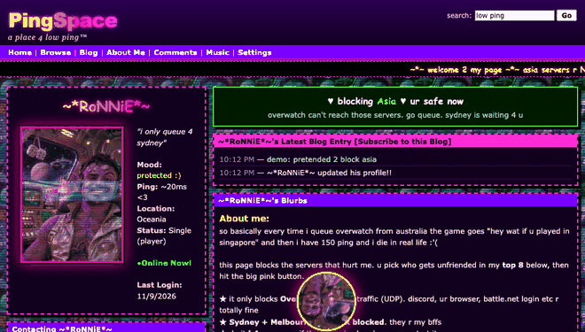
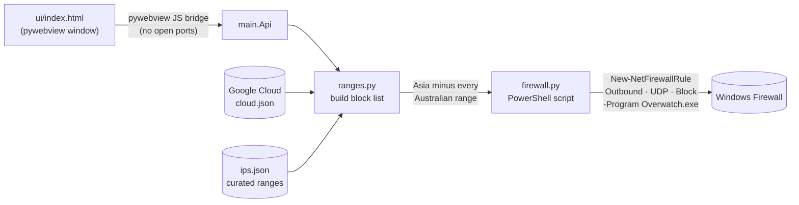

<div align="center">


# PingSpace

**Stop Overwatch putting Australian players on Asian servers.**

A tiny Windows app that adds firewall rules so Overwatch can't reach the servers you pick.<br>
Sydney and Melbourne are never blocked. Wrapped in a glittery 2006 profile page, because why not.

[](https://github.com/MJWNA/pingspace/releases/latest)
[](https://github.com/MJWNA/pingspace/actions/workflows/ci.yml)
[](https://github.com/MJWNA/pingspace/releases)
[](#requirements)
[](requirements.txt)
[](LICENSE)

[**Download**](https://github.com/MJWNA/pingspace/releases/latest/download/PingSpace.exe) ·
[**Install guide**](https://mjwna.github.io/pingspace/) ·
[**Live demo**](https://mjwna.github.io/pingspace/demo/) ·
[**How it works**](#how-it-works) ·
[**Changelog**](CHANGELOG.md)



</div>

---

## Why

Overwatch's matchmaker regularly places Oceanic players in Singapore, Tokyo, Seoul or Taipei, especially off-peak. That's 100 to 160 ms instead of 20. The game has no region lock for Oceania, so PingSpace makes the Asian servers unreachable from Overwatch.exe and the matchmaker falls back to Australian ones.

## Features

- **Australia-safe by construction.** Every Australian range is subtracted from the block list before any rule is written, and a test checks every combination of regions to prove it.
- **Scoped to the game.** Rules apply only to `Overwatch.exe` and only to UDP (game traffic). Battle.net login, Discord, browsers and other games are untouched.
- **Current IP data.** Ranges come from Google Cloud's published [`cloud.json`](https://www.gstatic.com/ipranges/cloud.json) (where Overwatch 2 servers run), fetched fresh on each block, with a bundled snapshot as an offline fallback. A hand-curated list covers Blizzard-owned and Korean ranges that aren't on Google Cloud.
- **All or nothing.** Rules are written inside a `try`/`catch`; if any rule fails, every rule is removed again, so you're never half-blocked.
- **Set and forget.** Rules persist across restarts. Open the app again only to unblock.
- **Single-file exe** built and self-tested by CI, published with a SHA-256 checksum.
- **A MySpace profile.** Top 8 friends are server regions, the mood is your block status, and an original 8-bit lullaby plays with glitch stutters synced to the visuals. Pause sticks.

## Quick start

### For players

1. Download **[PingSpace.exe](https://github.com/MJWNA/pingspace/releases/latest/download/PingSpace.exe)**.
2. Run it. Windows SmartScreen will warn because the exe isn't code-signed: **More info → Run anyway**. Accept the admin prompt.
3. Asia is pre-selected. Click **BLOCK EM**. Restart Overwatch if it's open.

To undo, open PingSpace and click **unblock all**.

Never touched a computer before? The **[step-by-step install guide](https://mjwna.github.io/pingspace/)** walks through every click.

### Requirements

| | |
|---|---|
| OS | Windows 10 or 11 |
| Runtime | [Microsoft Edge WebView2](https://developer.microsoft.com/microsoft-edge/webview2/) (preinstalled on Windows 11 and current Windows 10) |
| Rights | Administrator (Windows Firewall changes need it) |
| Game | Overwatch via Battle.net or Steam |

## How it works



1. **Collect ranges.** `ranges.py` takes every Google Cloud prefix whose region starts with `asia-` (plus `us-`, `europe-` and friends if you tick those) and adds the curated non-GCP ranges for the same regions. Google's `global` anycast scope is ignored.
2. **Protect Australia.** Every `australia-*` GCP prefix and every curated Australian range is cut out with `ipaddress.address_exclude`, splitting broader ranges where needed. The result is collapsed to the smallest set of CIDRs.
3. **Write rules.** `firewall.py` turns the list into one PowerShell script: remove the old `PingSpace` rule group, then `New-NetFirewallRule -Direction Outbound -Action Block -Protocol UDP -Program <Overwatch.exe>` in chunks of 200 addresses, rolling back on any error. The script runs from a temp file with `-File`, so no huge command lines.
4. **Read state.** On launch the app queries the `PingSpace` rule group to show what's currently blocked.

With the game's UDP traffic blocked, those servers look unreachable from your PC, and the matchmaker places you somewhere it can reach.

<details>
<summary><b>Why not just use the original IP list?</b></summary>

PingSpace started as a fork of [Peak2548/ow-server-switcher](https://github.com/Peak2548/ow-server-switcher). Checking its hand-made list against Google's published ranges found two bugs for Australian players: its Singapore list contains `34.124.0.0/16`, which includes the Sydney ranges `34.124.40.0/23` and `34.124.58.0/23`, and its Netherlands list contains `37.244.0.0/16`, which includes Blizzard's Sydney `37.244.42.0/24`. Choosing Australia in the original blocked some Australian servers. Its rules also applied to every program on the PC, not just Overwatch.

</details>

## Using it from source

```powershell
git clone https://github.com/MJWNA/pingspace.git
cd pingspace
python -m pip install -r requirements.txt
python main.py             # asks for admin, opens the window
python main.py --dry-run   # prints the PowerShell instead of running it
```

On macOS or Linux the app always runs as a dry run, which is handy for working on the UI. Opening `ui/index.html` in a browser gives a demo mode with a fake backend.

## Development

```powershell
python -m unittest discover -s tests -v   # unit tests, any OS
python tests/windows_integration.py       # real firewall round trip (Windows, admin)
python main.py --self-test                # bundled files + range maths
```

| Path | What it is |
|---|---|
| `main.py` | Entry point, admin elevation, pywebview window and the JS bridge (`Api`) |
| `ranges.py` | Loads Google and curated ranges, subtracts Australia, collapses CIDRs |
| `firewall.py` | Builds the PowerShell scripts, runs them, finds Overwatch.exe |
| `ui/index.html` | The whole interface: HTML, CSS, WebAudio chiptune, no external requests |
| `ips.json` | Curated per-region ranges (from the original project) |
| `data/gcp_ranges_snapshot.json` | Offline fallback copy of Google's `cloud.json` |
| `tests/` | Unit tests plus the Windows Firewall integration test |
| `docs/` | GitHub Pages: install guide (`index.html`) and live demo (`demo/`) |

### CI and releases

- **[CI](.github/workflows/ci.yml)** runs on `windows-latest` for every push and PR: unit tests, a real Windows Firewall round trip (create, read back, verify UDP/outbound/program scope, remove) and the app self-test.
- **[Release](.github/workflows/release.yml)** runs on a `vX.Y.Z` tag: checks the tag matches `version.py`, runs the tests, builds `PingSpace.exe` with PyInstaller, self-tests the built exe, and publishes a GitHub Release with notes from `CHANGELOG.md` and a SHA-256 checksum.

To cut a release: bump `version.py`, add a `CHANGELOG.md` section, commit, then `git tag vX.Y.Z && git push --tags`.

Versioning follows [SemVer](https://semver.org/).

### Refreshing the offline snapshot

```powershell
curl -o data/gcp_ranges_snapshot.json https://www.gstatic.com/ipranges/cloud.json
```

## FAQ

**Will this get me banned?** PingSpace only changes your own Windows Firewall. It doesn't read or modify game files, memory or packets. Blizzard hasn't published a position on firewall-based region selection, so use it at your own risk.

**Queues are longer.** Off-peak there are fewer Oceanic players. Blocking Asia trades queue time for ping; unblock if you'd rather have a game now.

**"Failed to connect to server".** The matchmaker occasionally still picks a blocked server. Requeue.

**Antivirus flagged it.** Unsigned PyInstaller executables sometimes trip heuristics. The exe is built in public CI from this source; compare its hash with the `.sha256` on the release, or run from source.

## Credits

- Original concept and curated IP list: [Peak2548/ow-server-switcher](https://github.com/Peak2548/ow-server-switcher)
- IP ranges: [Google Cloud published IP ranges](https://www.gstatic.com/ipranges/cloud.json)
- Window: [pywebview](https://github.com/r0x0r/pywebview)

Not affiliated with or endorsed by Blizzard Entertainment. Overwatch is a trademark of Blizzard Entertainment, Inc.

## License

[MIT](LICENSE)
